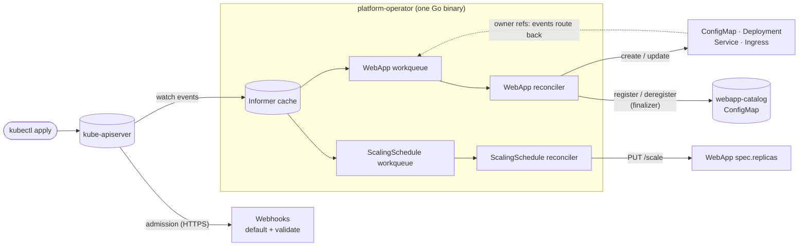

# platform-operator

A Kubernetes operator written in Go with [kubebuilder](https://book.kubebuilder.io) and
[controller-runtime](https://github.com/kubernetes-sigs/controller-runtime). It is built to
**learn from**: the code follows the patterns you find in real production operators, and every
non-obvious line explains *why* it is there.

It adds two custom resources to a cluster:

| Kind | Short name | What it does |
|---|---|---|
| `WebApp` | `wa` | A "golden path" for stateless HTTP services. From one small object the operator creates and owns a **ConfigMap**, **Deployment**, **Service** and optional **Ingress**. It rolls pods when config or a referenced Secret changes, reports health through status conditions, and registers the app in a cluster-wide catalog. |
| `ScalingSchedule` | `ss` | Time-based scaling, like a cron-driven HPA: "6 replicas on weekdays 08:00–18:00 London time, otherwise 2". It scales WebApps through their `/scale` subresource. |

```yaml
apiVersion: platform.example.com/v1alpha1
kind: WebApp
metadata:
  name: storefront
spec:
  image: nginxinc/nginx-unprivileged:1.27-alpine
  replicas: 2
  config:
    LOG_LEVEL: info
  secretRef:
    name: storefront-secrets
  ingress:
    host: storefront.local
```

```console
$ kubectl get webapps
NAME         IMAGE                                     DESIRED   READY   AVAILABLE   AGE
storefront   nginxinc/nginx-unprivileged:1.27-alpine   2         2       True        3m
```

## How it fits together



## What this project demonstrates

| Concept | Where to look |
|---|---|
| CRD design: spec/status, markers, defaults, enums, patterns | [`api/v1alpha1/`](api/v1alpha1) |
| CEL validation rules running inside the API server | `x-kubernetes-validations` markers in [`webapp_types.go`](api/v1alpha1/webapp_types.go), [`scalingschedule_types.go`](api/v1alpha1/scalingschedule_types.go) |
| Status subresource, **scale subresource**, printer columns, short names | markers above `type WebApp struct` |
| Level-triggered, idempotent reconcile loop | `Reconcile` in [`webapp_controller.go`](internal/controller/webapp_controller.go) |
| Owner references and garbage collection | `ensure()` in `webapp_controller.go` |
| `CreateOrUpdate` without fighting API-server defaults | [`webapp_resources.go`](internal/controller/webapp_resources.go) |
| **Finalizers** for cleanup that owner references can't do | `finalize()` and [`internal/catalog`](internal/catalog/catalog.go) |
| Status conditions (`Available`, `Progressing`, `Degraded`) and `observedGeneration` | [`webapp_status.go`](internal/controller/webapp_status.go) |
| Watching owned objects, unowned objects, field indexes, metadata-only watches | `SetupWithManager` in both controllers |
| Config-hash rolling restarts | `computeConfigHash` |
| Time-driven reconciling with `RequeueAfter`, injectable clock | [`scalingschedule_controller.go`](internal/controller/scalingschedule_controller.go) |
| Event predicates | `GenerationChangedPredicate` in the schedule controller |
| Optimistic concurrency and conflict retries | `retry.RetryOnConflict` in the catalog and `scaleTarget` |
| Defaulting and validating **admission webhooks**, warnings, cross-object checks | [`internal/webhook/v1alpha1/`](internal/webhook/v1alpha1) |
| Kubernetes events, Prometheus metrics, structured logging | `Recorder.Eventf`, [`internal/metrics`](internal/metrics/metrics.go) |
| Pure, unit-testable domain logic (DST-safe time windows) | [`internal/schedule`](internal/schedule/schedule.go) |
| Three layers of tests: plain Go, envtest integration, webhook-over-HTTPS | `*_test.go`, see [docs/07-testing.md](docs/07-testing.md) |
| Least-privilege RBAC generated from code | `+kubebuilder:rbac` markers → [`config/rbac/role.yaml`](config/rbac/role.yaml) |

## Quick start

### 1. Run the tests (no cluster needed)

```sh
make test
```

The first run downloads `etcd` and `kube-apiserver` into `./bin` (envtest). Tests then start a
real API server locally, install the CRDs and run the controllers against it. It takes about 20 s.

### 2. Run it in a local cluster

You need Docker (Docker Desktop, OrbStack or colima) and [kind](https://kind.sigs.k8s.io):

```sh
brew install kind kubectl   # also upgrades kubectl; v1.25 is too old for a 1.37 cluster
make dev-cluster            # kind cluster + cert-manager (needed for the webhooks)
make dev-deploy             # build image, load into kind, deploy operator
make dev-samples            # Secret + WebApp + ScalingSchedule
kubectl get webapps,scalingschedules
```

Full walkthrough, including running the operator from your laptop with `make run`:
[docs/08-running-locally.md](docs/08-running-locally.md).

## Learning path

Read these in order. Each one points at the exact functions it explains.

1. [Operators 101](docs/01-operators-101.md): controllers, reconcile loops, informers, workqueues
2. [Go concepts used in this repo](docs/02-go-concepts.md): a Go primer mapped to real code here
3. [Designing the API (CRDs)](docs/03-api-design.md): types, markers, validation, status, subresources
4. [The WebApp controller](docs/04-webapp-controller.md): the full reconcile, line by line
5. [The ScalingSchedule controller](docs/05-scalingschedule-controller.md): time, `/scale`, predicates
6. [Admission webhooks](docs/06-webhooks.md): defaulting, validation, warnings, CEL vs webhook
7. [Testing operators](docs/07-testing.md): unit tests, envtest, fake clocks, Eventually
8. [Running locally and deploying](docs/08-running-locally.md): kind, `make run`, cert-manager, debugging
9. [Production checklist](docs/09-production-checklist.md): what makes it production-grade, and what's missing
10. [Exercises](docs/10-exercises.md): extend the operator yourself

## Repository map

```
api/v1alpha1/               Your API: Go structs = CRD schema           (hand-written)
  zz_generated.deepcopy.go  DeepCopy methods                            (generated: make generate)
cmd/main.go                 Builds the manager, wires dependencies      (scaffolded, then edited)
internal/controller/        Reconcilers + their tests                   (hand-written)
internal/webhook/v1alpha1/  Admission webhooks + tests                  (hand-written)
internal/schedule/          Pure time-window logic, no Kubernetes calls (hand-written)
internal/catalog/           Cross-namespace catalog (finalizer demo)    (hand-written)
internal/metrics/           Custom Prometheus metrics                   (hand-written)
config/crd/bases/           CRD YAML                                    (generated: make manifests)
config/rbac/role.yaml       ClusterRole from RBAC markers               (generated: make manifests)
config/webhook/manifests.yaml Webhook configurations                    (generated: make manifests)
config/samples/             Example objects                             (hand-written, tested)
config/default, manager, …  Kustomize deployment manifests              (scaffolded)
test/e2e/                   End-to-end tests against a kind cluster     (scaffolded)
PROJECT                     kubebuilder metadata                        (generated: kubebuilder CLI)
```

**Never hand-edit generated files.** Change the Go types or markers, then run
`make manifests generate`.

## Everyday commands

| Command | What it does |
|---|---|
| `make manifests generate` | Regenerate CRDs, RBAC, webhook configs and DeepCopy code after editing types or markers |
| `make test` | Unit + envtest integration tests |
| `make lint` | golangci-lint with Kubernetes logging checks |
| `make run` | Run the operator on your machine against the current kubeconfig context |
| `make install` / `make uninstall` | Install / remove only the CRDs |
| `make deploy IMG=…` / `make undeploy` | Deploy / remove the full operator |
| `make help` | List every target |

## Tool versions

Scaffolded with kubebuilder v4.16.0 (`brew install kubebuilder`): Go 1.26+ (developed on 1.27),
controller-runtime v0.25, Kubernetes API v0.37, controller-tools v0.22.

> **Note:** The scaffold pinned golangci-lint v2.13.1, which cannot read packages compiled by
> Go 1.27 ("export data version 5"). The Makefile and `.custom-gcl.yml` were bumped to v2.15.0.
>
> The API group `platform.example.com` and module path `github.com/example/platform-operator`
> are placeholders. To rename them, change `go.mod`, the imports, `PROJECT` and the
> `+groupName` marker, then run `make manifests generate`.

## License

Apache 2.0 (kubebuilder's default header in `hack/boilerplate.go.txt`).
