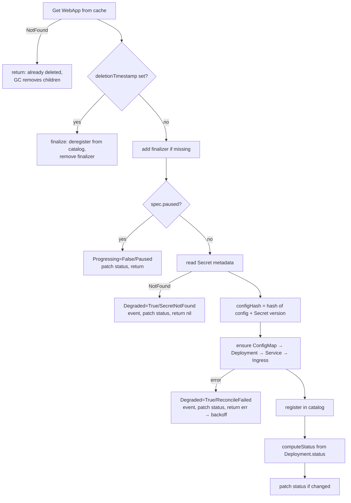

# 4. The WebApp controller

Files: `internal/controller/webapp_controller.go` (the loop), `webapp_resources.go` (desired
state builders), `webapp_status.go` (status), `internal/catalog/catalog.go` (finalizer target).

## The reconcile, step by step



### 1. Read from the cache

```go
app := &platformv1alpha1.WebApp{}
if err := r.Get(ctx, req.NamespacedName, app); err != nil {
    return ctrl.Result{}, client.IgnoreNotFound(err)
}
```

`NotFound` is normal: the object was deleted after the event was queued. Its children have owner
references, so the garbage collector cleans them up.

### 2. Finalizers

A finalizer is a string in `metadata.finalizers`. While any finalizer is present, `kubectl delete`
only **sets `deletionTimestamp`**. The object stays (shown as "Terminating") until every
finalizer is removed.

```
kubectl delete webapp shop
   │
   ▼
deletionTimestamp set ─► Reconcile ─► finalize():
                                       Catalog.Deregister(...)    (fails? return err, retry later)
                                       RemoveFinalizer + Update
                                          │
                                          ▼
                              API server deletes the object
                                          │
                                          ▼
                              GC deletes Deployment, Service, … (owner refs)
```

**Why we need one here.** The catalog ConfigMap lives in the operator's namespace. An owner
reference can't point across namespaces, so garbage collection would never remove a deleted
WebApp's catalog entry. Typical real-world finalizer targets: cloud load balancers, DNS records,
database users, buckets.

Rules that keep finalizers safe:

- **Add it before creating the external thing** (step 3 happens before `Catalog.Register`).
- **Make cleanup idempotent.** `Deregister` of a missing entry returns nil, because the
  finalizer may run several times.
- **Don't block forever on impossible cleanup.** If the catalog namespace is gone, `Deregister`
  treats it as already clean.
- **Uninstall order matters.** Delete all WebApps *before* removing the operator. Otherwise
  nobody is left to remove the finalizers, and the objects hang in Terminating. The escape hatch
  is `kubectl patch webapp shop --type=merge -p '{"metadata":{"finalizers":null}}'`.

### 3. Waiting on an input (the missing Secret)

If `spec.secretRef` names a Secret that doesn't exist, retrying with backoff is pointless. The
controller sets `Degraded=True/SecretNotFound`, emits a Warning event and **returns no error**.
The Secret watch (below) wakes it the moment the Secret is created. Choosing between "return
error" and "record and wait for a watch" is one of the key design decisions in any reconciler:

| Situation | Response | Why |
|---|---|---|
| Transient API failure | `return err` | Backoff will fix it |
| `409 Conflict` (stale cached copy) | Short `RequeueAfter`, no error log | Routine under optimistic concurrency; see `Reconcile` |
| Waiting for another object we watch | Record condition, `return nil` | The watch wakes us |
| Waiting for time to pass | `RequeueAfter` | Nothing will wake us otherwise |
| Invalid spec | Record condition, `return nil` | Only a user edit (which triggers an event) can fix it |

### 4. Creating children: `ensure()` and `CreateOrUpdate`

```go
dep := &appsv1.Deployment{ObjectMeta: childMeta(app)}
r.ensure(ctx, app, dep, func() { mutateDeployment(dep, app, configHash) })
```

`controllerutil.CreateOrUpdate` does:

1. `Get` the object. If it's missing, run `mutate`, then `Create`.
2. If it exists, keep a copy, run `mutate`, then compare with `equality.Semantic.DeepEqual`.
3. `Update` **only if something changed**.

Inside the mutate callback, `ensure` also:

- **Refuses to adopt** objects it didn't create. If a Deployment called `payments` already
  exists without our owner reference, reconciling fails with `Degraded` instead of silently taking
  it over. (Test: *refuses to take over a Deployment it did not create*.)
- Calls `SetControllerReference`, which sets the owner reference.

#### The defaulting trap

After you create a Deployment, the API server **fills in defaults** you never set:
`imagePullPolicy`, `terminationMessagePath`, `restartPolicy`, `dnsPolicy`, probe timeouts, and
more. If `mutate` built a brand-new `PodSpec` each time:

```go
// DON'T
dep.Spec.Template.Spec = corev1.PodSpec{Containers: []corev1.Container{{Name: "app", Image: img}}}
```

then step 2 would always see a difference (our version lacks the defaults). It would send an
update **on every reconcile**, forever. The fix, used throughout `webapp_resources.go`:

- Modify the existing object in place (`appContainer()` finds the existing container).
- Only set fields you own.
- If you set a struct the server defaults inside, set every field explicitly (see
  `ReadinessProbe`: `PeriodSeconds: 10, TimeoutSeconds: 1, …`).

The test *does not rewrite its children when nothing changed* checks that the Deployment's
`resourceVersion` stays the same across extra reconciles.

> **Server-side apply** (`client.Apply` with field managers) is the more modern answer to this
> problem. You send only the fields you care about and the server tracks ownership. It's a good
> exercise; see [10-exercises.md](10-exercises.md).

#### Immutable fields

A Deployment's `spec.selector` can't change after creation. `mutateDeployment` sets it only when
`dep.ResourceVersion == ""` (not yet created), and `selectorLabels()` must never change between
operator versions.

### 5. Rolling pods when configuration changes

Pods read env vars **once at startup**. Changing a ConfigMap or Secret doesn't restart them. The
standard trick is a hash in a **pod template annotation**:

```go
tmpl.Annotations["platform.example.com/config-hash"] = configHash
```

Any change to the pod template makes the Deployment controller do a normal, safe rolling
update. The hash covers `spec.config` (sorted) and the Secret's `resourceVersion`.

### 6. Status

`computeStatus` (in `webapp_status.go`) is a **pure function** of the WebApp and its Deployment.
It doesn't watch pods itself. The Deployment controller already summarises them in
`deployment.status`. Building on other controllers' status is how Kubernetes is layered.

`patchStatus` then:

1. stamps `observedGeneration`,
2. **skips the write if nothing changed**. Every write is a watch event that triggers another
   reconcile, so writing unconditionally can create a hot loop,
3. sends a **merge patch** to `/status`, which carries only changed fields and doesn't need a
   matching `resourceVersion`.

## Watches: deciding what wakes the controller

```go
ctrl.NewControllerManagedBy(mgr).
    For(&platformv1alpha1.WebApp{}).                    // 1
    Owns(&corev1.ConfigMap{}).                          // 2
    Owns(&appsv1.Deployment{}).
    Owns(&corev1.Service{}).
    Owns(&networkingv1.Ingress{}).
    WatchesMetadata(&corev1.Secret{},                   // 3
        handler.EnqueueRequestsFromMapFunc(r.webAppsForSecret)).
    WithOptions(controller.Options{MaxConcurrentReconciles: 2}).
    Complete(r)
```

1. **`For`**: the primary resource. Any change to a WebApp reconciles that WebApp.
2. **`Owns`**: a change to a child is mapped through its controller owner reference. When a pod
   becomes ready, the Deployment's status changes, and that reaches us here. If someone runs
   `kubectl delete deployment storefront`, we are woken and recreate it (self-healing).
3. **`Watches` with a map function**: Secrets aren't owned by WebApps, so we need our own
   mapping from "Secret X changed" to "which WebApps use X?". A **field index** makes that a cheap
   cache lookup:

   ```go
   mgr.GetFieldIndexer().IndexField(ctx, &WebApp{}, ".spec.secretRef.name", func(o client.Object) []string {...})
   r.List(ctx, &apps, client.InNamespace(ns), client.MatchingFields{".spec.secretRef.name": secret.Name})
   ```

   `WatchesMetadata` caches only Secret **metadata** (name, labels, resourceVersion), never the
   secret values. It uses less memory and keeps credentials out of the operator's heap. To read
   those objects you must use `metav1.PartialObjectMetadata` (see `secretVersion()`). Note that
   RBAC still grants `list/watch` on Secrets; metadata-only is an efficiency and hygiene measure,
   not an access control.

**Cache scope.** Each `Owns`/`Watches` type is cached cluster-wide. For big clusters you can
restrict the cache with `cache.Options{DefaultNamespaces: …}` or label selectors (`ByObject`) in
`cmd/main.go`.

## Events, logs, metrics

- **Events** (`r.Recorder.Eventf(...)`) are for *users*. They appear in
  `kubectl describe webapp storefront` and `kubectl events --for webapp/storefront`. Emit them for
  things a human should notice: `RolloutTriggered`, `SecretNotFound`, `IngressDeleted`.
- **Logs** are for *operators of the operator*. They use structured key/value pairs:
  `log.Info("Reconciled child object", "kind", kind, "name", name)`. Messages start with a
  capital letter and keys are lowerCamel; the `logcheck` linter enforces Kubernetes conventions.
- **Metrics**: `platform_webapp_ready_replicas{namespace,name}` is a gauge, set every reconcile
  and deleted in the finalizer so dead series don't linger.

## RBAC from markers

```go
// +kubebuilder:rbac:groups=apps,resources=deployments,verbs=get;list;watch;create;update;patch;delete
```

`make manifests` collects every marker into `config/rbac/role.yaml`. Grant the minimum: WebApps
get no `create`/`delete` (users do that), and Secrets are read-only. If you forget a marker, the
symptom is a `forbidden` error in the logs and a `Degraded` condition. envtest doesn't enforce
RBAC, so only a real cluster or e2e test catches it.

Next: [5. The ScalingSchedule controller](05-scalingschedule-controller.md)
